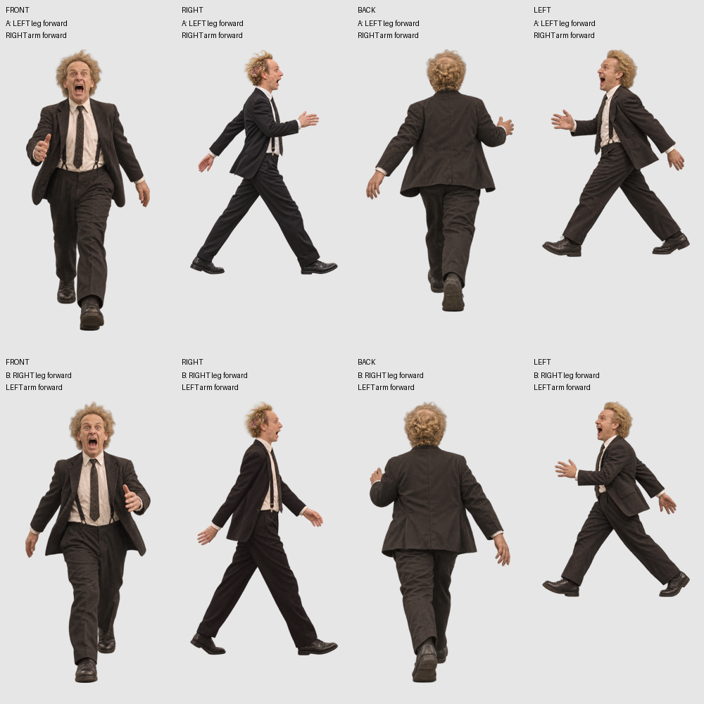

# Presentation and artwork coverage

The original 256×192 split renderer remains the default and the source reference. Isometric and Photoreal use the same World instance, rooms, player, guests, pockets, score and effect state. Changing a presentation selector does not start a new game.

## Geometry

Isometric projects the recovered x/y coordinate plane with equal-scale orthographic world axes. Door positions and entity collision extents come from decoded records. Original data is a set of sprite projections, not complete 3D models: wall elevations, furniture volume, material choices and the continuous stair mesh are inferred and labelled accordingly. All 14 room layouts can be viewed using inferred geometry and original sprite billboards. This is not a claim of full recovered 3D architecture.

Room 6 is the representative hallway. Its source records contain two sets of three stair components (types 47/48/49), an umbrella stand (44), and five coats (45). The scene uses these identities and positions. Open-boundary records and narrow door alignment retain the original collision meaning.

## Photoreal pilot

Generated assets are separate cutouts/materials rather than a static room painting: the player, guest archetypes, coats, umbrella stand, assembled staircase, floor texture and wall texture render independently with current world state and camera orientation. Props elsewhere still use original/inferred representations. Photoreal Split is not yet covered; choosing Split retains original split artwork and reports that limitation.

The player identity/outfit is based on the man in the [original Spectrum cassette inlay](https://worldofspectrum.org/pub/sinclair/games-inlays/h/HowToBeACompleteBastard.jpg), linked by the [World of Spectrum catalog](https://worldofspectrum.org/archive/software/games/how-to-be-a-complete-bastard-virgin-games-ltd). The cover, rather than a guessed television costume, is the authority: light messy hair, narrow expressive face, open-mouthed irreverent expression, black suit, white shirt, patterned dark tie, visible black braces, black trousers and shoes. The downloaded reference is private; only newly generated derivatives are included here.

Two guest archetypes currently stand in for the sixteen guest IDs. This is not complete unique guest portrait coverage. Full effect/disguise artwork, many furniture types and end sequences are still missing or fall back to original art. No full-photoreal-game completion claim is made.

## Frame indexing and acceptance

`tools/index-atlases.py` measures alpha-separated source figures rather than trusting requested grid dimensions. It found that the female sheet crosses nominal uniform row boundaries; using a naïve 4×5 crop would include neighboring feet/head fragments. The generated pixels were not edited: source rectangles and ground/root anchors were corrected instead. `atlas-index.json` and `frame-audit.json` record actual bounds, source checksums and nonempty/distinct cell checks.

Nonempty or pixel-different cells do not prove different anatomical gait phases. Player contact poses are audited separately for genuinely alternating left-leg/right-leg lead and corresponding arm swing before being accepted into the active walk loop. Generated candidate rows that repeat a lead leg must not be called complete animation coverage. The labelled contact sheets and rendered clips in the local recovery evidence are the visual acceptance record.

The active player loop now selects eight visually reviewed contact cutouts: left-leg lead and right-leg lead for each of front, right, back and left. Each phase lasts 280 ms. Idle uses four separate standing pictures. `player-contacts.json` maps the accepted source rectangles, anatomical phase labels and file hashes; `tools/index-player-contacts.py` reproduces those bounds and the contact sheet. The earlier 20-cell player sheet remains a candidate source; its walk rows are **not** selected by the active player loop. Guest candidate cycles still require equivalent anatomical acceptance. Two contact phases establish alternation, not a fully sampled cinematic gait.

Original isometric side rendering uses contact-A → passing-A → contact-B → passing-B, source indices 0, 1, 3, 2. It anchors the cutout by its head/root, compensating for the original byte-aligned four-pixel position changes. This adaptation is confined to Isometric; the original Split compositor and its 56 parity fixtures remain unchanged.

Original body data has two front images, four side images, and two back images; the side images are also mirrored for the opposite facing. Extra bytes reachable by naïvely indexing four front/back frames are not valid player phases. Interaction menus generally hold the actor rather than selecting a separate recovered full-body interaction strip; disguise/effect states need their own further recovery and artwork.

All generated artwork uses the built-in image-generation tool. Pose/atlas metadata and prompts document the asset process. Materials and generated human cutouts are lazily loaded when Photoreal is selected; they do not increase the original-mode initial asset load. Physical mobile performance remains unverified.
